<p align="center">
  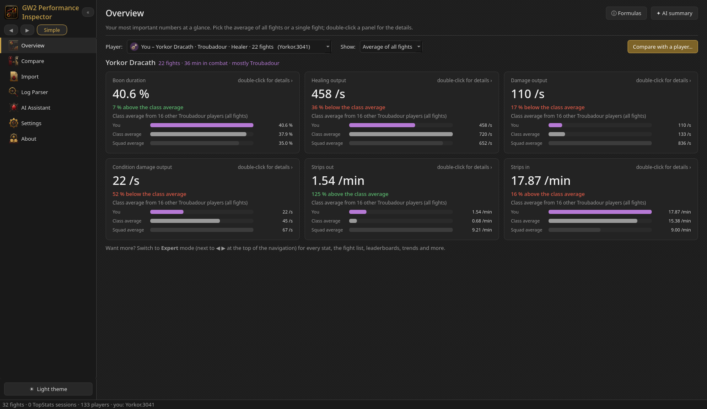
</p>

<h1 align="center">GW2 Performance Inspector</h1>

<p align="center">
  <b>WvW combat log analysis for Guild Wars 2</b> – see how you really perform, compare yourself with your squad
  and learn what to work on next.<br>
  Runs on <b>Windows 10/11</b> and <b>Linux</b>, completely on your own PC. Free, made by <b>Tenga</b>.
</p>

<p align="center">
  <a href="../../releases/latest"><b>⬇ Download the latest version</b></a> ·
  <a href="#start-it">Start it</a> ·
  <a href="#what-it-does">What it does</a> ·
  <a href="#questions--problems">Help</a> ·
  <a href="LICENSE">License</a>
</p>

> All screenshots use real WvW logs with **made-up player names**.

---

## Download

Get the file for your system from the **[latest release](../../releases/latest)**:

| System | File | |
|---|---|---|
| **Windows 10 / 11** (64-bit) | `GW2-PerformanceInspector-1.6.0-Windows.zip` | unzip, double-click the .exe |
| **Linux** (64-bit, glibc 2.35+: Ubuntu 22.04+, Debian 12+, Mint 21+, Fedora 36+, Arch, CachyOS, Garuda, …) | `GW2-PerformanceInspector-1.6.0-Linux.AppImage` | one file, make it executable |
| **In-game overlay** (optional, Windows game client – also under Proton / Wine) | `GW2-PerformanceInspector-Overlay-1.6.0.zip` | `arcdps_gw2pi.dll` – into `addons/` with Nexus, into the game folder with arcdps only |

Both are complete: no Python, no installer, no admin rights. Your logs, stats and settings stay on your PC.

## Start it

### Windows
1. Right-click the zip → **Extract All…** (for example into `Documents`).
2. Open the folder **GW2 Performance Inspector** and double-click **GW2 Performance Inspector.exe**.
   Tip: right-click the .exe → *Pin to taskbar*.
3. Windows may show *“Windows protected your PC”* (SmartScreen) because the app is new and not signed:
   click **More info → Run anyway**.

### Linux
```bash
chmod +x GW2-PerformanceInspector-1.6.0-Linux.AppImage
./GW2-PerformanceInspector-1.6.0-Linux.AppImage
```
Or right-click the file → *Properties* → *Allow executing as program*, then double-click it.
If nothing happens, install FUSE 2 once (`sudo apt install libfuse2` – on Ubuntu 24.04: `libfuse2t64`,
`sudo pacman -S fuse2`, `sudo dnf install fuse-libs`) or start it with `--appimage-extract-and-run`.

### First start
A short introduction helps you set up:
* a desktop icon, if you like (asked once – Settings can make one later),
* your theme and your account (`Name.1234` – the one shown in the squad list),
* your **arcdps log folder** – the app finds it for you, also in every Steam library on every drive.

The game data (names and icons from the official Guild Wars 2 API) downloads by itself when the introduction ends
and is refreshed once a month.

Then drop your logs in, or let the app watch your log folder and import every new fight while you play.

### Updating
Download the new version and replace the old file / folder. Your data and settings are kept – they are stored
separately in your user folder.

---

## What it does

Drop in your arcdps logs and every fight becomes numbers you can act on:

* **A score and a grade for every fight**, based on the role you actually played (DPS, Condi DPS, Healer, Boon
  Support, Stripper, Cleanser – hybrids get several roles), compared with the players around you.
* **Your Top 3 things to work on** – with movement, camera handling and About Face first for newer players.
* **Fair comparisons** – counts are per minute of each player's own combat time, so someone who joined late or died
  early isn't judged on totals.
* **Every number explained** – hover any column header or chart for its formula.
* **Game icons next to every boon, condition and stat**, like Elite Insights and TopStats show them.
* **One fight selection for the whole app** – the button at the top right of every page: tick days in a calendar,
  or play sessions, folders and single fights in the fight library. An unticked fight is left out of every number
  until you tick it again – nothing is deleted. It also shows how the pages count (selected → you took part → too
  short → in your stats).
* **Live session** – while you play, every new log is imported right away and *My Raids* shows the evening so far,
  with a card of your last fight. Tick what you play for (DPS, Strip, Heal, Boon Support, Condition cleanse, Downs
  contribution, Death) and your score and tips use only that. No popups take the keyboard from the game.
* **A built-in parser that matches Elite Insights** – checked player by player: damage, cleanses, CC, deaths, downs
  and dodges match exactly, boons, strips, healing and down contribution within 1 %.
* **An AI assistant** that explains fights, reports and game mechanics – built-in answers by default, an optional
  local AI that runs on your PC (nothing is sent away).

### Simple or Expert – you choose

**Simple mode** (the default) keeps it to the basics: the **Overview** with your six key numbers – boon duration,
healing, damage, condition damage, strips out and strips in – for all your fights or a single fight, each next to
the average of your class and your squad. Plus My Raids (with the live session), Compare, Import & Library, the Log
Parser, the AI Assistant, the basic settings (incl. clearing your data) and About.

Double-click any Overview panel for the details: a chart over your fights (or second by second for one fight) and
the ranking of the squad.

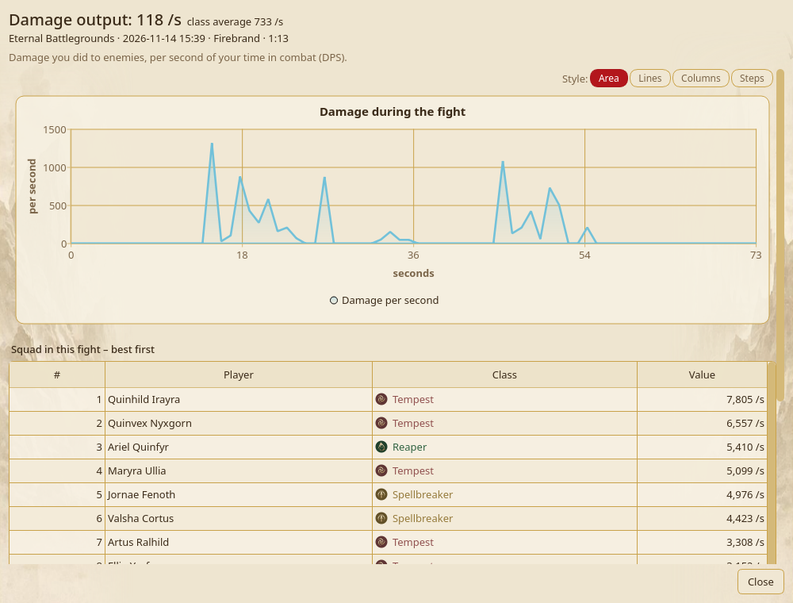

**Expert mode** shows every page and setting in four groups: *Overview* (Overview, Dashboard, Players, Compare,
My Raids), *My performance* (Performance Review, Support & Defense, Offensive & Strips, Deaths & Positioning,
Inspect Me), *Fights & logs* (Import & Library, Log Parser, Fights, Log Summary) and *Tools*. Switch any time with
the button next to ◀ ▶ at the top of the navigation.

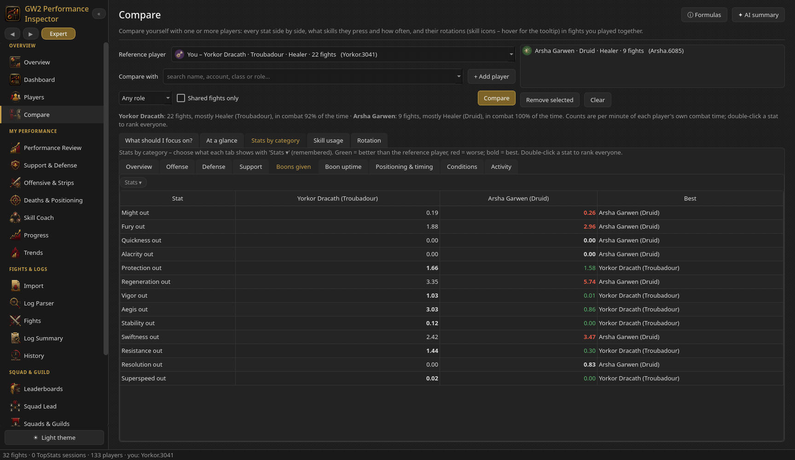

### Supported logs

| Source | How |
|---|---|
| arcdps `.zevtc` / `.evtc` / `.evtc.zip` | built-in parser – nothing else needed (incl. healing / barrier from the healing-stats addon) |
| Elite Insights | `.json` / `.json.gz` files, `.html` fight pages, or a dps.report / wvw.report link |
| TopStats / GW2_EI_log_combiner / TopStatsAIO | summary JSON and HTML reports (current and LEGACY layout), wvwlogs.com links |

Right-click any fight or report → **Export HTML…** to save it as a page you can share.

---

## A tour

### My Raids and the live session
One page for the evening: the **Live session** panel (every new log imported right away, the session so far, a card
of your last fight and *Rate me for*), Raid Night, Leaderboards, Squad Lead, Squads & Guilds and the squad
composition – as panels you arrange yourself.

### Inspect Me – your own improvement
**Your share of the squad** (your part of the squad's healing, stability, damage … per fight, against what your
role usually brings), a **Practice plan** with three targets for your next session, plus Trends, Progress and the
Skill Coach (BETA).

### Players – everyone you fought with
Click any player to see all their stats in category tabs, compared with the average and the top 10 % of their class.

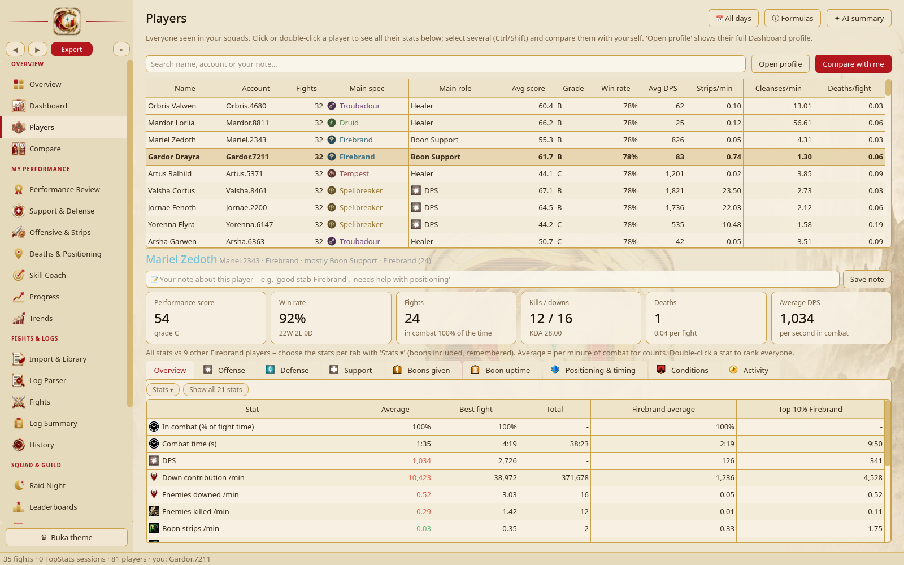

### Support & Defense · Offensive & Strips
Your numbers against players of **your own class**, with a top-10 list next to every section: damage mitigation,
boon generation and uptime, strips, bomb timing, fight phases and more.

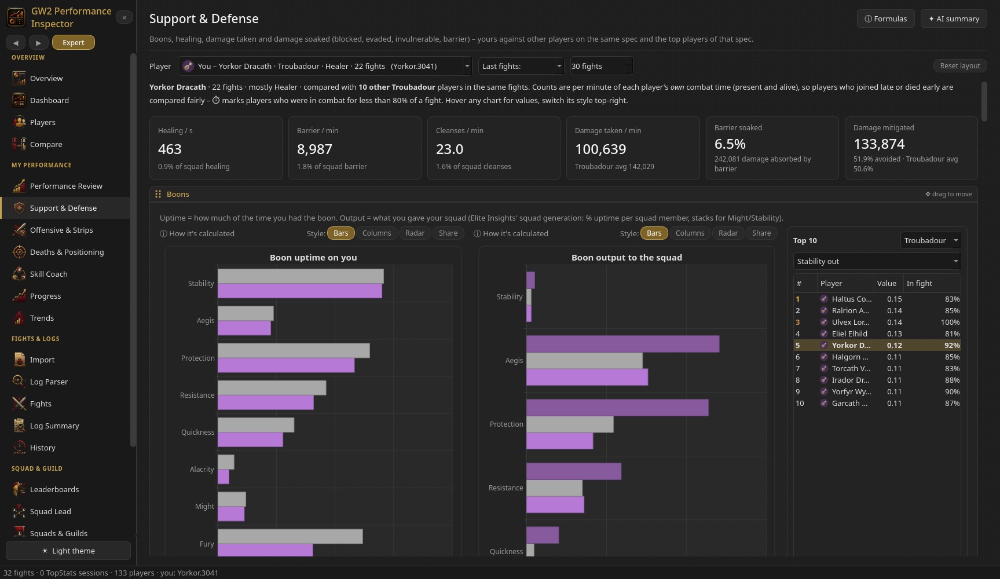

Every section is a **panel you can drag** – put them next to each other and the layout is remembered.

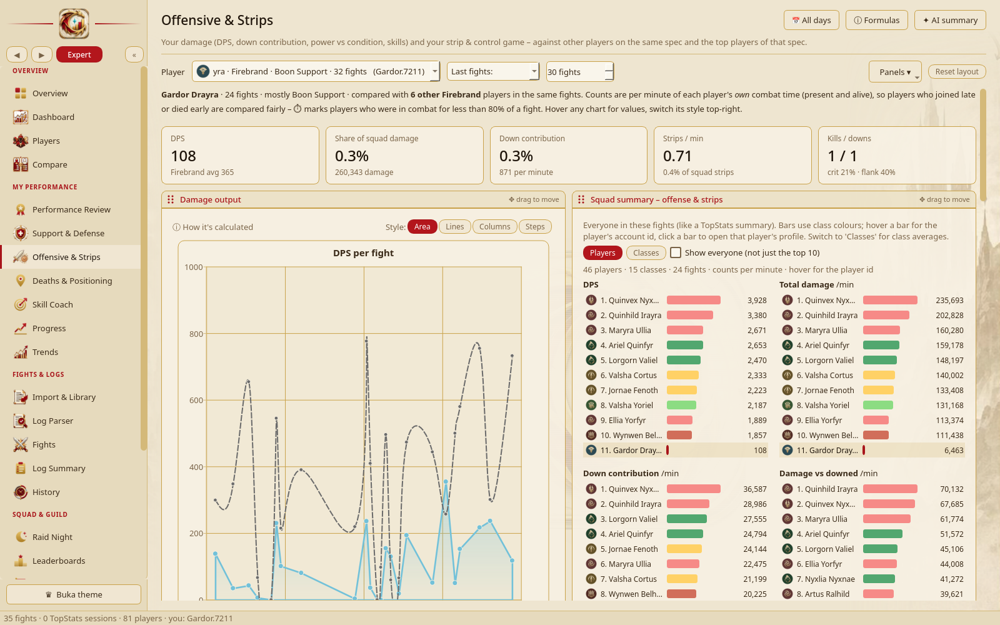

### Deaths & Positioning
Every time you went down: what hit you, what you had up, how far you were from the commander – and a replay of the
moment with class icons, your position and the commander tag.

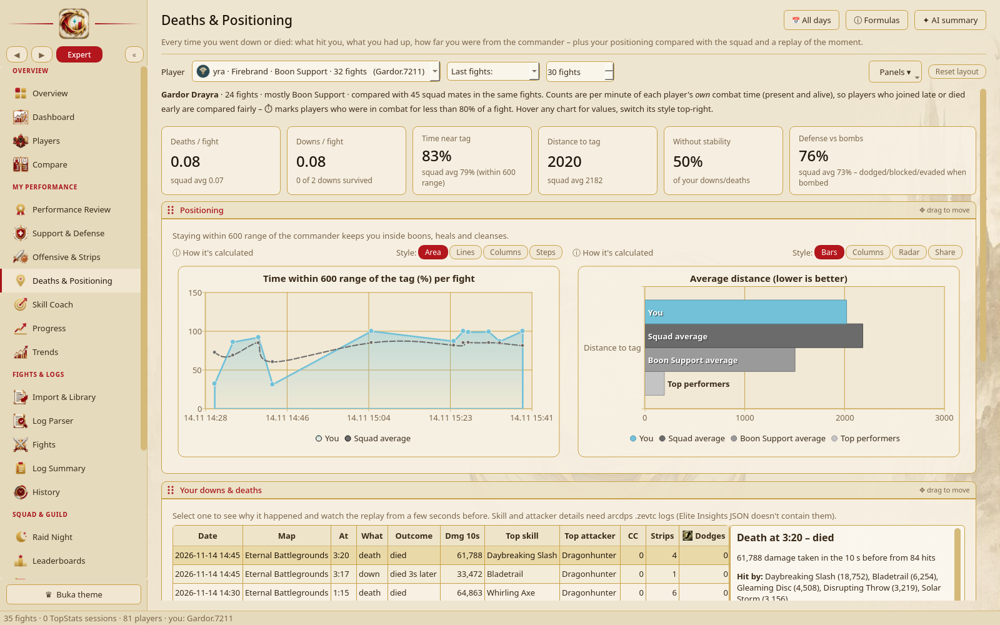

### Fight reports with the AI Coach
Every fight opens as a report with tabs (Overview, Squad, Offense, Support, Defense, Boons, Enemies, Players). The
**AI Coach** explains the tab you are looking at and sums up every column: your value and rank, the average and
the top performer.

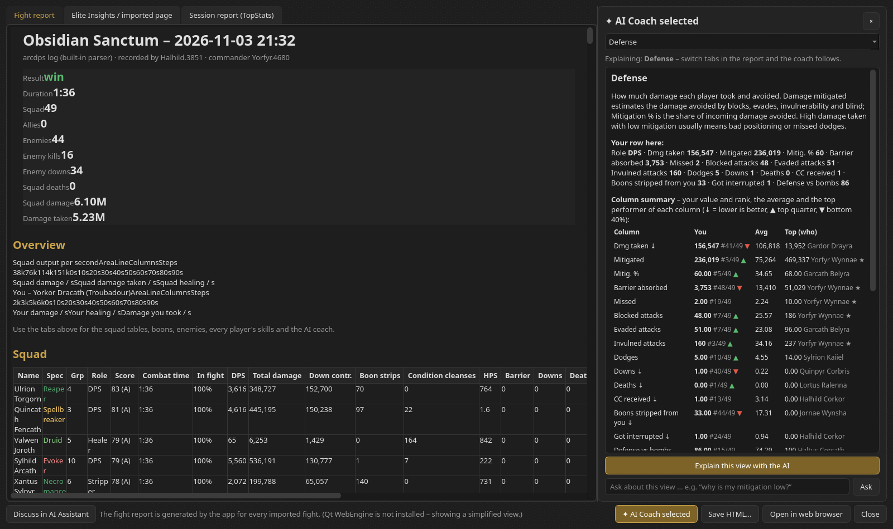

### Log Summary and the Log Parser
TopStats-style tables for a whole session, and the **Log Parser** that turns a play session into a shareable report
with one of four engines: the app's own parser, the EI Log Combiner (Elite Insights + TopStats), TopStatsAIO or
Legacy TopStats – or *Compare* the built-in parser with Elite Insights side by side. The parser has its own
workspace: parsing never changes your stats.

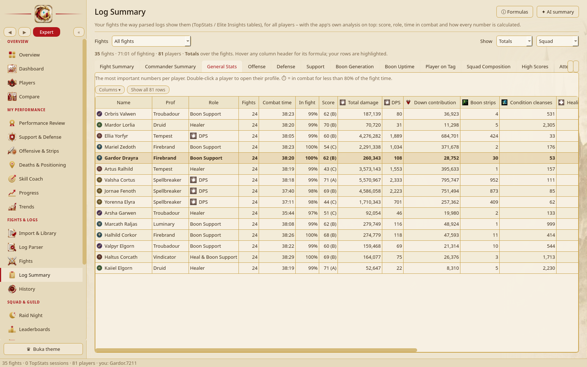

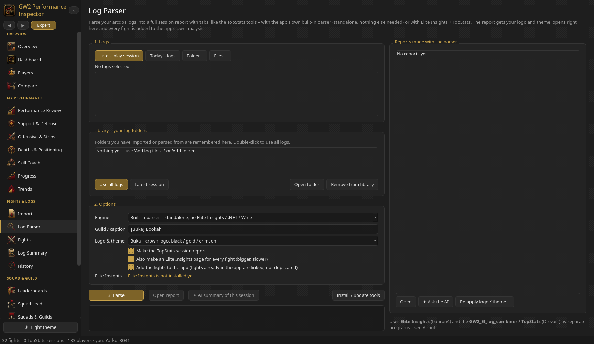

### Trends and the Performance Review
Follow your stats over time with role-based trend cards (on Inspect Me), and get a full review with benchmarks that
adjust to the players in your logs.

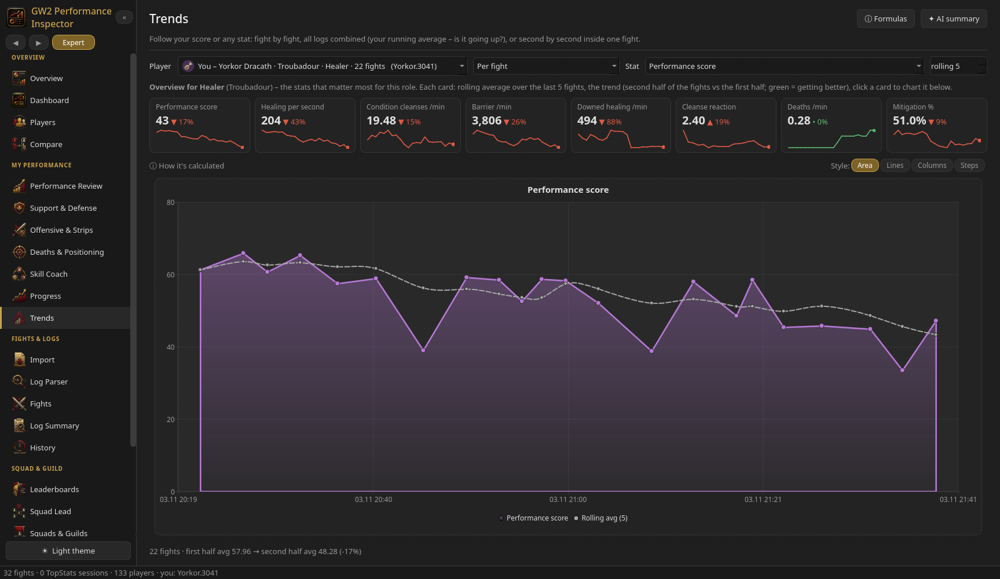

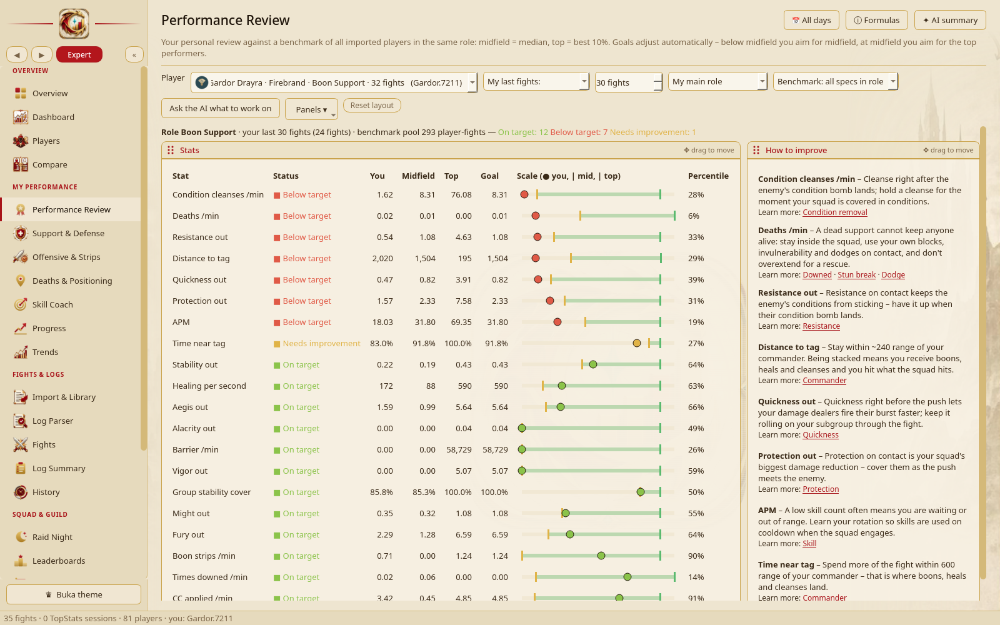

### Raid Night – for commanders
One evening on one page (a panel of My Raids): results, who carried (top 3 per job), who died most and the likely
reason, and boon uptime per subgroup. Pick the evening with the fight selection and use *Copy as image* to post it
in Discord.

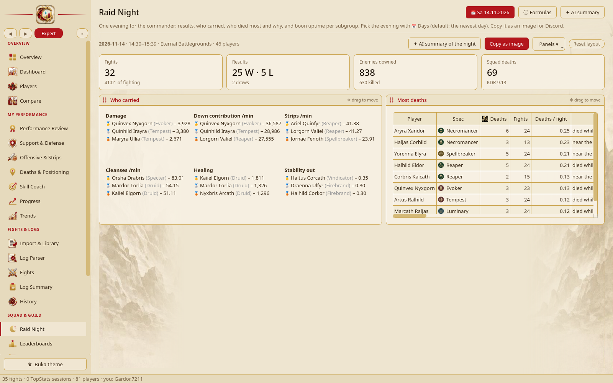

### Themes
**Tyria** (default – parchment, crimson and old gold with a misty landscape and the dragon-crescent emblem),
**Grey** (with the app logo hologram), **Buka** (with the guild crown hologram), **QWOP** (with the polar bear hologram),
**Ka** (sunny sky with clouds and the Ka logo), **Black/Grey** and **Light** – picked in the first-start introduction or any time from the sidebar.

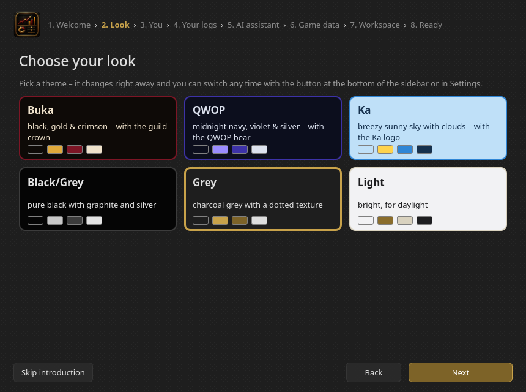

### And more
Squads & Guilds (win rates by map, size, commander and time, guild rosters), History with session charts (a tab of
Fights), Progress with goals and personal bests, Skill Coach with build checks and cooldown usage, notes on play
sessions and logs, players in a floating window or added to Compare from anywhere, back / forward navigation, log
folders with a fight library and log sessions, pages you arrange yourself (panels you drag into place), an in-game
overlay (arcdps / Nexus) to start log sessions, see the live session and parse from inside the game – and maybe a
little secret or two.

---

## Optional extras

The app downloads these only when you use them, and keeps the parser tools on their newest release (checked once a
day when the app starts):

| Extra | What for | Needs |
|---|---|---|
| Local AI (Qwen via llama.cpp) | AI Coach and AI Assistant with a real language model (Settings → AI, Expert mode) | 1.2 GB (Light) or 2.6 GB (Standard) download; runs on your graphics card or CPU |
| Elite Insights | EI Log Combiner, Legacy TopStats, TopStatsAIO, Compare, EI fight pages | .NET 10 – when it is not installed, the app downloads Microsoft's runtime into its own tools folder (no Wine) |
| EI Log Combiner (TopStats) | TopStats session reports | Windows: nothing (TopStats.exe); Linux: `python3` installed on the PC |
| Legacy TopStats | the older TopStats WvW Log Review | `python3` installed on the PC (Windows and Linux) |
| TopStatsAIO | darkharasho's all-in-one parser in its own window | nothing extra |

## Privacy

Everything runs on your computer. Your logs, stats and settings stay in your user folder. The app only goes online
to download game data and icons (official Guild Wars 2 API and render service, Guild Wars 2 wiki), the optional
AI model (Hugging Face), the parser tools you use (from their GitHub releases, plus Microsoft's .NET runtime for
Elite Insights) and – if you choose to – dps.report pages.
A GW2 API key is optional and stays on your PC.

## Questions & problems

* **Windows says the app is unsafe** – it is new and not signed by a company: *More info → Run anyway*. If your
  antivirus removes a file, restore it and add the app folder as an exception.
* **The AppImage does not start** – install FUSE 2 (see [Linux](#linux)) or run it with `--appimage-extract-and-run`.
* **No fights after importing** – very short fights (default: under 20 s) and non-WvW logs are skipped.
* **Healing is 0** – healing and barrier only exist in logs recorded with the arcdps *healing stats* addon.
* **Enemy players have no names** – combat logs never contain them; enemies are shown by team colour.
* **Check your download** – every file has a `.sha256` next to it:
  Linux `sha256sum -c GW2-PerformanceInspector-1.6.0-Linux.AppImage.sha256` ·
  Windows (PowerShell) `Get-FileHash GW2-PerformanceInspector-*-Windows.zip` and compare.

Found a bug or have an idea? Contact **Tenga** ([GitHub: t3ng4](https://github.com/t3ng4)). In the app,
Settings (Expert mode) → *Diagnostics* → **Export diagnostics…** makes a zip that helps finding problems (API keys are removed,
combat logs are not included).

---

## Credits

Developed by **Tenga** ([GitHub: t3ng4](https://github.com/t3ng4)).

Shout out to **Buka**, **Ka**, **QWOP** and **RIP BiG**. Auto log parser and the QWOP theme & logo by **Chase**.

Built on the work of:
[arcdps](https://www.deltaconnected.com/arcdps/) (deltaconnected) ·
[arcdps healing stats](https://github.com/Krappa322/arcdps_healing_stats) (Krappa322) ·
[Elite Insights](https://github.com/baaron4/GW2-Elite-Insights-Parser) (baaron4 & contributors) ·
[GW2_EI_log_combiner / TopStats](https://github.com/Drevarr/GW2_EI_log_combiner) (Drevarr) ·
[TopStatsAIO](https://github.com/darkharasho/TopStatsAIO) (darkharasho) ·
[wvwlogs.com](https://wvwlogs.com/) · the [Guild Wars 2 API](https://api.guildwars2.com/v2) (ArenaNet) ·
[llama.cpp](https://github.com/ggml-org/llama.cpp) · [Qwen](https://huggingface.co/Qwen) ·
[Qt for Python](https://doc.qt.io/qtforpython/) · [Nuitka](https://nuitka.net/).

## License

**[CC BY-NC-ND 4.0](https://creativecommons.org/licenses/by-nc-nd/4.0/)** – you may use the app for free and share
it unchanged; you may **not** use it commercially, and you may **not** share modified versions of the app, the
artwork or the credits. See [LICENSE](LICENSE) for details, including third-party parts.

The Buka and QWOP logos belong to their guilds and are used with permission. Guild Wars 2 and all related names
and images are trademarks of ArenaNet, LLC. This app is a fan-made tool and is not affiliated with or endorsed by
ArenaNet or NCSOFT.
